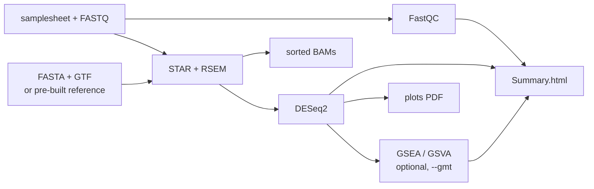

# nf-rnaseq

A minimal, production-oriented **bulk RNA-seq pipeline** in [Nextflow](https://www.nextflow.io/) (DSL2):
**STAR + RSEM** quantification, **DESeq2** differential expression, optional **GSEA** (fgsea) and
**GSVA**, FastQC, and a one-page `Summary.html`.

- Built for **Slurm clusters with Apptainer**; a Docker profile is provided for local development and tests.
- All tools run from public BioContainers images **pinned by sha256 digest**.
- Single-end or paired-end, multiple lanes per sample, any number of contrasts.
- Inputs, tool versions and file checksums are recorded in `pipeline_info/`.



## Contents

[Requirements](#requirements) · [Quick start](#quick-start) · [Inputs](#inputs) ·
[Parameters](#parameters) · [Outputs](#outputs---outdir) · [Methods](#methods-in-brief) ·
[Limitations](#limitations) · [Tests](#tests) · [Updating containers](#updating-container-digests) · [License](#license)

## Requirements

- Nextflow >= 25.04 (needs Java 17+); tested with 26.04.3. If `module load` reports a conflict, `module unload nextflow` first
- Docker (local) **or** Apptainer (HPC); internet access to `quay.io` for the first image pull
- Python 3 only for the test scripts

## Quick start

Local, Docker (development, small data):

```bash
nextflow run . -profile local,docker \
    --input samples.csv --contrast pairs.txt \
    --gfasta genome.fa --gtf genome.gtf --outdir results
```

Slurm + Apptainer (the intended use):

```bash
cp conf/site.example.config site.config      # set resourceLimits for your cluster, clusterOptions
export NXF_APPTAINER_CACHEDIR=/path/to/shared/apptainer_cache   # image cache (not an `apptainer {}` block in site.config)
nextflow run . -profile slurm,apptainer -c site.config --queue <partition> \
    --input samples.csv --contrast contrasts.csv \
    --gfasta genome.fa --gtf genome.gtf --outdir results
```

Reuse a reference (the first run publishes it to `results/reference/rsem_star`):

```bash
nextflow run . -profile slurm,apptainer -c site.config --queue <partition> \
    --rsem_ref results/reference/rsem_star --gtf genome.gtf \
    --input samples.csv --contrast contrasts.csv --outdir results2
```

`nextflow run . --help` prints all parameters; every script in `bin/` has `--help`;
`bin/pipeline_help.sh` prints the commands above. Re-run after a failure with `-resume`.
There is no "build the reference only" mode in v0.1.0: the reference is built as part of a normal
run and reused through `--rsem_ref`.

## Inputs

**Samplesheet** (`--input`, CSV with header):

```
sample,fastq_1,fastq_2,strandedness,condition,batch
ctl_1,ctl_1_R1.fq.gz,ctl_1_R2.fq.gz,reverse,control,b1
```

- Empty `fastq_2` = single-end. All rows must agree (single-end and paired-end are not mixed).
- `strandedness`: `forward`, `reverse` or `none` (RSEM's `--strandedness`). It is taken as
  declared and never inferred (dUTP/TruSeq stranded libraries are `reverse`). Behaviour measured
  on the synthetic reverse-stranded data: declaring the opposite strand (`forward`) makes RSEM fail
  with "No valid read to estimate the length distribution!", so the task stops; declaring `none`
  for a stranded library gives the same gene counts (14815 vs 14815 fragments in one sample) but
  loses strand specificity, which is **not visible in the totals** - declare the real strandedness.
  If unsure, check the library kit documentation. A wrong declaration does **not always** stop the
  run: it can finish with only a small fraction of reads in the gene counts. The pipeline warns when
  a sample has fewer than 30 % of its input reads in the gene counts.
- A sample may have several rows (lanes). Lanes are passed to RSEM/STAR as comma-separated
  lists, not concatenated. All files of a sample must share compression.
- Sample names: `[A-Za-z0-9._-]+`. FASTQ **file names** must be unique across the sheet. Absolute
  paths are used as given. Relative paths (so a bare file name is enough) are resolved against
  `--fastq_dir` if it is set, otherwise against the samplesheet's directory.
- Extra columns (e.g. `batch`) can be used in `--design`; all design variables are treated as
  factors.

**Contrasts**: either `--contrast FILE` with just the pairs you want, one per line
(`treatment,control`; comma or tab; `#` comments; an optional third column names the variable,
default `condition`):

```
# desired contrasts: treatment,control
treated,control
drugB,control
```

or the full CSV `id,variable,treatment,control` (e.g.
`t_vs_c,condition,treated,control`); `--contrast` accepts both formats. For pairs the id is `<treatment>_vs_<control>`. A first row made only of the words
`id/variable/treatment/control` is read as a header (so a level named `control` is fine, but a
pair whose two levels are literally `treatment` and `control` would look like a header).
`<A>_vs_<B>` **always means fold change A/B**: `log2FoldChange = log2(treatment/control)`
(positive = higher in treatment), in file names, plot titles, GSEA (positive NES = enriched in
treatment) and GSVA (`mean_diff = treatment - control`).

**Unreplicated samples are skipped.** A sample that is the only one with its level of a contrast
variable (e.g. the single `drugC` sample when `condition` has levels `control`, `treated`, `drugC`)
is removed from the entire analysis: it is not aligned, quantified, size-factor-normalized, tested,
plotted or listed in `Summary.html`. A warning is written to `pipeline_info/validation_warnings.txt`,
and any contrast naming that level is dropped (an error if no contrast is left).

**Reference**: either `--rsem_ref DIR` (RSEM+STAR reference, built with `rsem-prepare-reference
--star`) or `--gfasta` + `--gtf` (built by the pipeline). `--gtf` is always required (gene names and
biotypes come from it). The reference is checked before any alignment: required files, STAR index
version compatible with the container's STAR, GTF contigs match the reference (>= 90 %), and
reference genes are in the GTF.

**Gene sets** (`--gmt a.gmt,b.gmt`): one or more GMT files (comma-separated, no spaces), e.g. MSigDB
Hallmark/KEGG/GO or your own; each line is `set name<TAB>description<TAB>gene1<TAB>gene2...`. Giving
`--gmt` turns on GSEA (fgsea on the DESeq2 Wald statistic) and GSVA, per contrast and GMT file; without
it neither runs. No gene sets are bundled. The genes must be of the same species as the GTF and use
the identifiers named by `--gmt_id_type`: `gene_name` (symbols, default; MSigDB) or `gene_id` (as in
the GTF). Matching is exact and case-sensitive. Validated up front, but only a GMT with *no* usable
set is an error; poor overlap is only a warning in the validation task's output.
**Use a GMT of the same species:** MSigDB `*.Hs.symbols.gmt` files (human, upper-case symbols such as
`TP53`) do not match mouse symbols (`Trp53`); use the `Mm` collections for mouse. A wrong-species
file leaves few usable sets; the pipeline warns when fewer than half are usable.

## Parameters

| parameter | default | meaning |
|---|---|---|
| `--input`, `--outdir` | required | samplesheet, output directory |
| `--contrast` | required | pair list or full contrasts CSV |
| `--fastq_dir` | samplesheet's directory | directory that relative FASTQ paths in the samplesheet are resolved against |
| `--gtf` | required | GTF (annotation; also builds the reference) |
| `--gfasta` | required unless `--rsem_ref` | genome FASTA |
| `--rsem_ref` | – | pre-built RSEM+STAR reference directory |
| `--star_sjdboverhang` | `auto` | `auto` = max read length of the first sample - 1, or an integer (build only) |
| `--design` | `~ condition` | additive formula, e.g. `~ batch + condition` |
| `--padj` | 0.05 | cutoff, also `alpha` of `results()` / independent filtering |
| `--lfc` | 1 | \|log2FC\| threshold, volcano plot only |
| `--min_count` | 10 | genes with a lower total count are not fitted (kept with NA statistics) |
| `--gmt` | – | GMT file(s), comma-separated; enables GSEA + GSVA |
| `--gmt_id_type` | `gene_name` | identifiers in the GMT: `gene_name` (symbols) or `gene_id` (GTF gene_id) |
| `--min_set_size`, `--max_set_size` | 5, 500 | gene-set size limits for GSEA and GSVA |
| `--gsva_input` | `vst` | `vst` or `log2tpm` (TPM is compositional; VST is recommended) |
| `--gsva_top` | 10 | gene sets per GSVA plot page |
| `--pca_ntop` | 500 | most variable genes used for PCA |
| `--run_date` | today | `DDMMYY`, only used in the plot file name |
| `--no_bam` | false | do not write genome BAMs |
| `--queue` | – | Slurm partition (with `-profile slurm`) |

Profiles: executors `local`, `slurm`; containers `docker`, `apptainer`; `test` (synthetic data).
Combine one of each, e.g. `-profile slurm,apptainer`.

## Outputs (`--outdir`)

```
Summary.html                  read-quality and mapping tables
diffexp/                      dds.rds, Deseq2_res_<treatment>_vs_<control>.csv
expression/                   RSEM_expected_counts.txt, TPM.txt, FPKM.txt, DESeq2_normalized_counts.txt
plot/plots_DDMMYY.pdf         one PDF, batched: global PCA, PCA per contrast, MA, volcano, padj bar,
                              GSEA bubble, GSVA boxplots (1 + 4 x contrasts + 2 x contrasts x GMT pages)
bam/                          <sample>.genome.sorted.bam(+.bai), genome coordinates (not with --no_bam)
gsea/, gsva/                  raw tables per contrast x GMT file
fastqc/                       FastQC reports
reference/                    annotation.tsv, rsem_star/ (when built here)
pipeline_info/                params.json, versions.yml, inputs_sha256.json, trace.txt, validation_warnings.txt
```

The DESeq2 CSV columns are: `gene_id, gene_name, gene_biotype`, the size-factor-normalized counts
of the replicates of the two contrasted groups, then `baseMean, log2FoldChange, lfcSE, stat,
pvalue, padj`. All four `expression/` tables use the same gene and sample order.

## Methods in brief

- **Alignment/quantification:** `rsem-calculate-expression --star` (STAR 2.7.10a, RSEM 1.3.3). STAR's
  genome BAM is unsorted, so it is sorted and indexed with samtools; RSEM's own BAMs are off.
- **DESeq2:** counts = `round(expected_count)` into `DESeqDataSetFromMatrix` (no tximport, no
  length offsets). **One** `DESeq()` fit on all samples with the full design; every contrast is
  taken from it with `results(contrast = c(variable, treatment, control), independentFiltering =
  TRUE, alpha = --padj)`. Dispersion is therefore estimated from all groups. Genes removed by
  independent filtering keep `padj = NA`. No LFC shrinkage anywhere.
- **GSEA:** fgsea on the unshrunken Wald `stat`. **GSVA:** Gaussian kernel on VST (or log2 TPM+1),
  then a Welch t-test of the scores per contrast (no covariate adjustment).
- **Provenance:** sha256 of the FASTA/GTF/reference, tool versions and image digests are recorded.

## Limitations

- No read trimming (pre-trim externally). No shared-memory STAR genome loading.
- One sample layout and one strandedness declaration per sample; mixed single/paired-end runs are
  rejected. Only local files (no remote paths).
- The read length for `--star_sjdboverhang auto` comes from the first sample only.
- GSVA test is a two-group Welch t-test; it ignores design covariates.

## Tests

`tests/run_tests.sh [--profile test,docker]` is the single entry point: shellcheck, unit tests,
`--help` tests, profile resolution, and an integration run on synthetic data (paired-end with a
two-lane sample, single-end, pre-built reference, `--no_bam`, error cases) with checks against the
simulation truth (recall/false positives, direction of the fold change, golden normalized counts).
It needs Docker and takes about 25 minutes. On a cluster run `tests/verify_hpc.sh`.

## Updating container digests

Tags are listed in `tools/pin_containers.py`. Change a tag, run
`python3 tools/pin_containers.py --write` (resolves digests on quay.io and rewrites
`conf/containers.config`), then `tests/run_tests.sh`. `--check` detects a moved tag.

## License

MIT, see [LICENSE](LICENSE).
